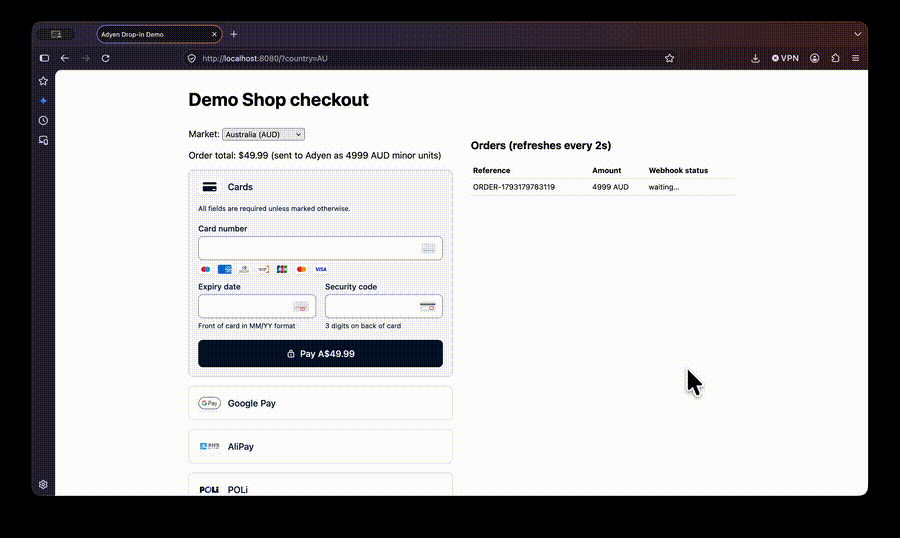
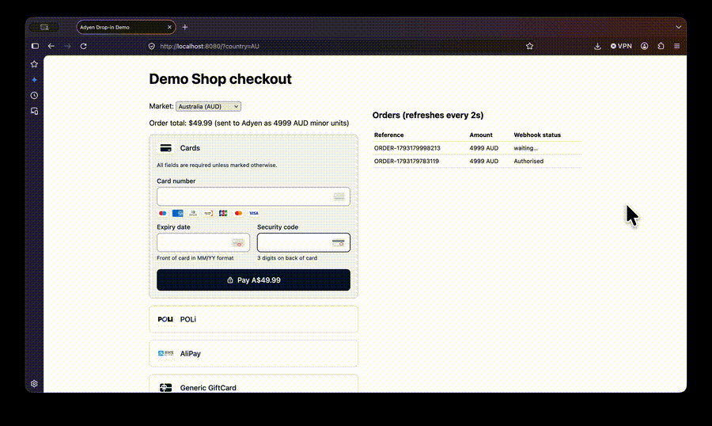
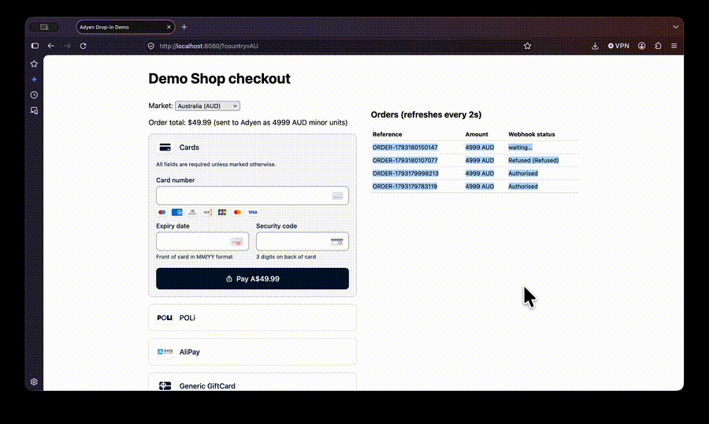

# Adyen Drop-in demo

Card payment successful


Card payment with 3DS authentication


Card payment declined


Minimal Sessions flow: the server makes one `/sessions` call, Drop-in handles payments, 3DS and redirects, and webhooks confirm the result.

```
Browser (Drop-in + session)  ──────────────────→  Adyen Checkout API
        │                                             ↑       │
        └─→  server.py (API key) ── POST /sessions ───┘       │
                    ↑                                         │
                    └──────── webhooks (HMAC-verified) ───────┘
```

## Run

```bash
python3 -m venv .venv && source .venv/bin/activate
pip install -r requirements.txt
cp .env.example .env   # fill in keys
python server.py       # must be http://localhost:8080 (allowed origin)
```

## Webhooks

```bash
ngrok http 8080   # keep running; copy the exact "Forwarding" https URL (.app or .dev)
python scripts/setup_webhook.py https://<forwarding-url>   # prints ADYEN_HMAC_KEY
# add ADYEN_HMAC_KEY to .env, restart python server.py
python scripts/check_webhooks.py   # Adyen sends a test event; expect responseCode=200
```

## Test data

| Scenario | Card | Expiry / CVC |
|---|---|---|
| Authorised | 4111 1111 1111 1111 | 03/30 / 737 |
| 3DS2 challenge | 4917 6100 0000 0000 | 03/30 / 737 (password `password`) |
| Refused | 4111 1111 1111 1111 with holder name `DECLINED` | 03/30 / 737 |

More: https://docs.adyen.com/development-resources/testing/test-card-numbers